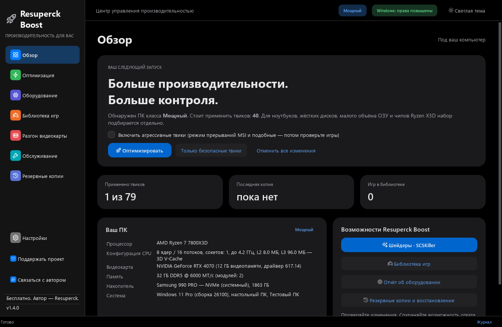

# Resuperck Boost

[English](README.md)

Бесплатное приложение для Windows 10 / 11 x64: информация о компьютере, настройки Windows, игровые профили и графические инструменты в одном интерфейсе.

- [Сайт](https://resuperck.pages.dev/)
- [Скачать 1.4.1 для Windows](https://github.com/kluchkoartem3-hash/resuperck-boost/releases/download/v1.4.1/ResuperckBoost-Setup-1.4.1.exe)
- [Исходники программы и инструкции сборки](https://github.com/kluchkoartem3-hash/resuperck-boost/releases/download/v1.4.1/ResuperckBoost-1.4.1-sources.zip)
- [Описание релиза и контрольные суммы](https://github.com/kluchkoartem3-hash/resuperck-boost/releases/tag/v1.4.1)
- [Издатель, официальные источники и проверка файла](AUTHORSHIP.md)
- [Написать разработчику через сайт](https://resuperck.pages.dev/#contact)

В 1.4.1 появились помощник по приложению, подключение внешнего лаунчера Melty и установка с удалением бета-мода коопа для Deus Ex GOTY. Облачному помощнику не нужна загрузка модели; бесплатная квота общая, а обычная справка доступна без сети. Помощник не управляет ПК. Melty использует собственный каталог — универсального создания коопа или объединения любых игр по кнопке нет.

Скриншот использует демонстрационные данные. Графические функции зависят от игры и оборудования; в играх с ограничениями античита используйте штатные настройки.

Установка и восстановление кооп-мода проверены на тестовых папках; совместимость в самой игре пока не проверена. В этом репозитории размещён сайт. Код приложения, инструкции сборки и лицензии зависимостей находятся в архиве исходников по ссылке выше.
